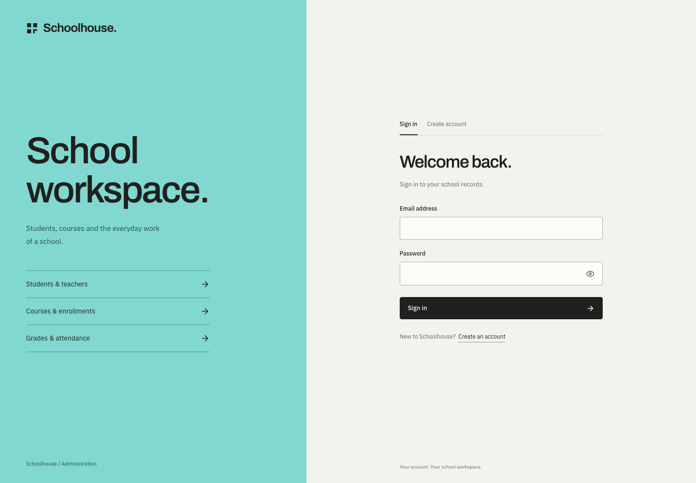
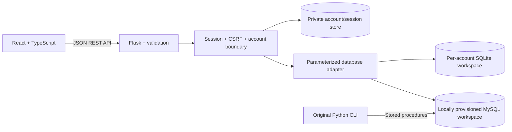

# Schoolhouse

A full-stack school administration workspace built with **React, TypeScript, Python and a relational database**. Students, teachers, courses, enrollments, grades and attendance share a connected interface with Tiffany navigation, clear typography and a live weekly timetable.

The web application extends the Python CLI and MySQL schema in this repository. Each registered account gets a private SQLite workspace, with optional fictional records so you can explore the workflow without configuring a database server.




## Run locally

Requires Python 3.10+ and Node.js 22.12+ (or 20.19+).

From the repository root:

```bash
python3 -m venv .venv
source .venv/bin/activate
pip install -r requirements.txt
npm --prefix frontend ci
npm --prefix frontend run build
python -m backend.app
```

Open **http://127.0.0.1:5001** and choose **Create account**. Registration signs you in and creates a private SQLite workspace. No `.env` or MySQL server is needed to try the application.

Choose **Include sample school records** to start with 24 fictional students, 4 teachers, 6 courses, 36 enrollments and seven days of attendance. Uncheck it to start empty. Accounts have separate records, IDs and CSV exports. There are no default/shared passwords. Use **Sign out** in the sidebar to end the session.

Account hashes and server-side sessions live in `backend/state/accounts.db`; school records live in `backend/state/workspaces/<account-id>.db`. Both are Git-ignored. Back up this private state directory together if you want to preserve accounts and records. Signing out or restarting does not delete your workspace. Any older `backend/demo.db` is preserved and is not exposed through a newly registered account.

For development with hot reload, start `python -m backend.app` in one terminal and `npm --prefix frontend run dev` in another, then open http://127.0.0.1:5173. Vite proxies `/api` to the Python server on port 5001.

## What works

- **Accounts:** registration, sign-in, sign-out, password confirmation/visibility, and persisted 12-hour server-side sessions. Passwords use scrypt hashing; session cookies are HttpOnly and SameSite=Lax. State-changing requests require a CSRF token and same-origin validation, and authentication attempts are rate-limited.
- **Overview:** live record counts, interactive seven-day attendance history, weekday course timetable and recent enrollments.
- **Students and teachers:** create, edit, delete, search, sort, filter and paginate records.
- **Courses:** manage credits, classroom, weekday and class time.
- **Enrollments:** connect a student, course and teacher; record an enrollment date and update the grade.
- **Attendance:** record Present, Late or Absent for an enrollment and date, and edit historical entries.
- **Data quality:** server validation, relational checks, duplicate enrollment/attendance checks, transaction rollback and confirmation before destructive changes.
- **CSV export:** export every entity; cells that could be interpreted as spreadsheet formulas are escaped. Export includes the entire entity, regardless of active UI filters.
- **Responsive interface:** mobile navigation, horizontally scrollable data tables, native focus-trapping dialogs, visible keyboard focus, labeled controls and reduced-motion support. Use Cmd/Ctrl+K to focus directory search.
- **Local fonts:** Archivo and IBM Plex Sans are served with the app; their SIL Open Font License notices are in `frontend/public/fonts/`.


## Use the existing MySQL database

The web adapter uses the same five tables and column names as `database.sql`. It executes parameterized queries; the original CLI continues to use its stored procedures.

1. Use an existing `SchoolManagementSystem` database with the repository's schema, or initialize a disposable database separately. **The original `database.sql` begins with `DROP DATABASE`; do not run it against a database you need to keep.**
2. Copy `.env.example` to `.env` and set your local connection details:

```dotenv
SCHOOL_DB=mysql
MYSQL_HOST=localhost
MYSQL_PORT=3306
MYSQL_USER=your_user
MYSQL_PASSWORD=your_local_password
MYSQL_DATABASE=SchoolManagementSystem
```

3. Provision the account that is allowed to access this existing schema using the local terminal:

```bash
python -m backend.manage create-mysql-account --name "Your name" --email "you@example.com"
```

Enter and confirm the password at the hidden prompts. The command checks the configured schema before creating the account. Only one account can own the existing MySQL workspace. Public registration always creates an independent SQLite workspace and cannot grant itself access to MySQL.

4. Restart `python -m backend.app` and sign in with the provisioned account. Its interface will show **MySQL workspace**. It never seeds or recreates your MySQL database.

The original CLI is available with `python main.py`; its controller is `db_controller_2.py`. Both CLI and web adapter read MySQL credentials from environment variables or `.env`, which Git ignores. Account/session storage is separate SQLite metadata even when the school records use MySQL. The automated integration suite uses SQLite; a live MySQL connection still needs to be verified in your own environment.

## Architecture



```text
frontend/src/          React screens, shared record forms and design tokens
backend/app.py         JSON API, validation, CSV exports and frontend serving
backend/database.py    SQLite/MySQL adapter and isolated fictional seed
backend/auth.py        Account hashes, opaque sessions and persisted rate limits
backend/auth_routes.py Authentication routes and API access boundary
backend/manage.py      Local provisioning for the existing MySQL workspace
main.py                Original interactive CLI
models.py              Original student and teacher models
db_controller_2.py     Original MySQL stored-procedure controller
database.sql           Original MySQL schema and stored procedures
tests/                 API/database integration tests
frontend/e2e/          Desktop and mobile browser workflow tests
PRODUCT.md             Product scope and confirmed constraints
DESIGN.md              Implemented visual system
```

The original technical report, SQL integration script and CSV import pipeline remain in the repository. `import_data.py` is the original import tool; its source CSV path and mapping are separate from the web demo.

## API

| Method | Endpoint | Behavior |
| --- | --- | --- |
| GET | `/api/health` | API availability and account-store check |
| GET | `/api/auth/session` | Current account and CSRF token, or anonymous state |
| POST | `/api/auth/register` | Create an account and its own workspace |
| POST | `/api/auth/login` | Verify credentials and rotate the session |
| POST | `/api/auth/logout` | Revoke the session and clear its cookie |
| GET | `/api/data` | All five record collections and demo flag |
| POST | `/api/{entity}` | Validate and create a record |
| PUT | `/api/{entity}/{id}` | Validate and update a record |
| DELETE | `/api/{entity}/{id}` | Delete, cascading through related records |
| GET | `/api/export/{entity}` | Download entity CSV |

School-data endpoints require a signed-in account. POST/PUT/DELETE requests also require the session’s `X-CSRF-Token` header. Authentication errors return 401, missing/invalid CSRF tokens or foreign origins 403, and rate limits 429 with `Retry-After`. The frontend obtains the token from `/api/auth/session` and keeps it in memory.

Entities: `students`, `teachers`, `courses`, `registrations`, `attendance`. Payloads use the existing schema's column names. Students, teachers and courses require an explicit positive ID; the form suggests the next available ID. Registration and attendance IDs are assigned by the database. Validation failures return JSON errors with HTTP 422, duplicate IDs/emails 409, missing records 404 and malformed JSON 400.

## Verification

```bash
.venv/bin/python -m pytest -q
npm --prefix frontend run build
cd frontend
npx playwright install chromium
npm run test:e2e
```

The browser suite starts an API on port 5002 with temporary account and workspace databases and a frontend on port 5174. It never modifies your accounts, workspaces or MySQL data. If you use an installed Chrome instead, run `PLAYWRIGHT_CHANNEL=chrome npm run test:e2e`. A GitHub Actions workflow runs the API tests, production build and desktop/mobile browser tests.

To refresh screenshots after building the frontend (the script starts and stops its own temporary capture server and creates only an isolated test account):

```bash
PLAYWRIGHT_CHANNEL=chrome node scripts/capture.mjs
```

## Scope and next steps

This is an **authenticated local administrator application and portfolio demo**. Each account owns its workspace; shared staff memberships, student/teacher roles, email verification, password recovery and MFA are not implemented. The application reads complete record collections into the browser and is intended for small datasets. Enrollment/date duplicate checks remain application-level guards; database constraints and stronger concurrency handling are future work.

For internet deployment, configure HTTPS and `SCHOOL_COOKIE_SECURE=true`, a production WSGI server, persistent private state storage and a correctly configured trusted reverse proxy that preserves the original host. Rate limits use the server-observed client IP; do not blindly trust arbitrary forwarded headers. The current SQLite account store targets a single deployment with a persistent local volume, not distributed multi-region hosting. The original MySQL schema is not rewritten or made public by registration.

## Portfolio notes

See [docs/PORTFOLIO.md](docs/PORTFOLIO.md) for a concise CV bullet, demo walkthrough and interview topics. The original CLI/database foundation is the author’s own work; this version adds the web application. Describe that progression and be ready to explain and maintain both layers.
