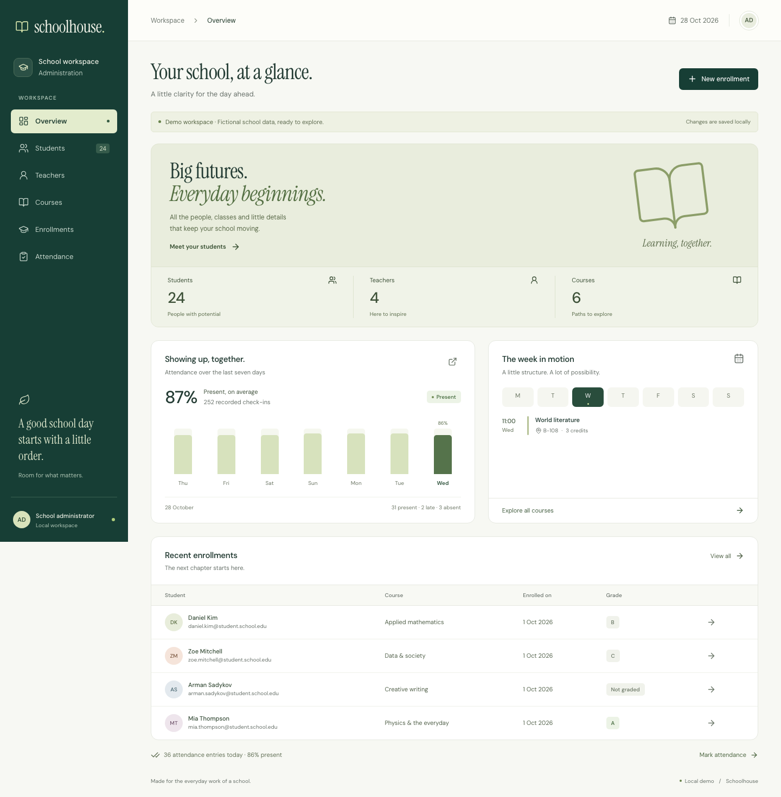
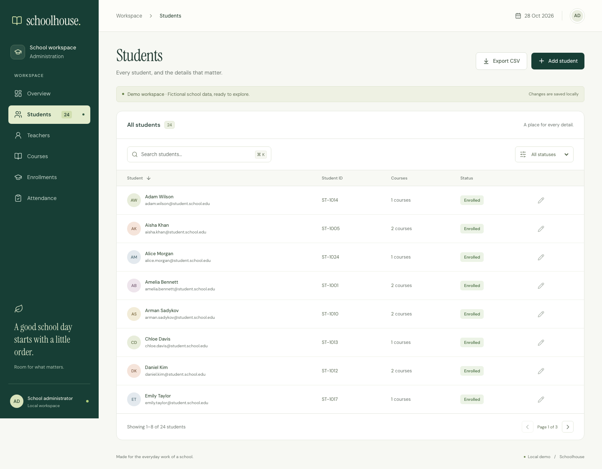
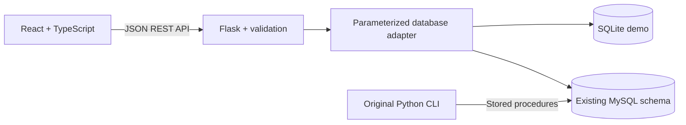

# Schoolhouse

A full-stack school administration workspace built with **React, TypeScript, Python and a relational database**. Students, teachers, courses, enrollments, grades and attendance share one quiet, connected interface.

The web application extends the Python CLI and MySQL schema in this repository. It includes a separate SQLite demo so you can explore the complete workflow without configuring a database server.



## Run locally

Requires Python 3.10+ and Node.js 22.12+ (or 20.19+).

From the repository root:

```bash
python3 -m venv .venv
source .venv/bin/activate
pip install -r requirements.txt
npm --prefix frontend ci
npm --prefix frontend run build
python -m backend.app
```

Open **http://127.0.0.1:5001**. The Python server serves both the API and the built frontend. No `.env` or MySQL setup is needed for the demo.

The first run creates `backend/demo.db` with **24 fictional students, 4 teachers, 6 courses, 36 enrollments and seven days of attendance**. Changes persist across refreshes and restarts. Demo data is labeled in the interface. To reset the demo, stop the server, back up or delete only `backend/demo.db`, and restart. This never resets MySQL.

For development with hot reload, start `python -m backend.app` in one terminal and `npm --prefix frontend run dev` in another, then open http://127.0.0.1:5173. Vite proxies `/api` to the Python server on port 5001.

## What works

- **Overview:** live record counts, interactive seven-day attendance history, weekday course timetable and recent enrollments.
- **Students and teachers:** create, edit, delete, search, sort, filter and paginate records.
- **Courses:** manage credits, classroom, weekday and class time.
- **Enrollments:** connect a student, course and teacher; record an enrollment date and update the grade.
- **Attendance:** record Present, Late or Absent for an enrollment and date, and edit historical entries.
- **Data quality:** server validation, relational checks, duplicate enrollment/attendance checks, transaction rollback and confirmation before destructive changes.
- **CSV export:** export every entity; cells that could be interpreted as spreadsheet formulas are escaped. Export includes the entire entity, regardless of active UI filters.
- **Responsive interface:** mobile navigation, horizontally scrollable data tables, native focus-trapping dialogs, visible keyboard focus, labeled controls and reduced-motion support. Use Cmd/Ctrl+K to focus directory search.
- **Local fonts:** DM Sans and Instrument Serif are served with the app; their SIL Open Font License notices are in `frontend/public/fonts/`.



## Use the existing MySQL database

The web adapter uses the same five tables and column names as `database.sql`. It executes parameterized queries; the original CLI continues to use its stored procedures.

1. Use an existing `SchoolManagementSystem` database with the repository's schema, or initialize a disposable database separately. **The original `database.sql` begins with `DROP DATABASE`; do not run it against a database you need to keep.**
2. Copy `.env.example` to `.env` and set your local connection details:

```dotenv
SCHOOL_DB=mysql
MYSQL_HOST=localhost
MYSQL_PORT=3306
MYSQL_USER=your_user
MYSQL_PASSWORD=your_local_password
MYSQL_DATABASE=SchoolManagementSystem
```

3. Restart `python -m backend.app`. The interface will show **MySQL workspace**. It never seeds or recreates the MySQL database.

The original CLI is available with `python main.py`; its controller is `db_controller_2.py`. Both CLI and API read credentials from environment variables or `.env`, which Git ignores. The web application's automated integration suite uses SQLite; a live MySQL connection still needs to be verified in your own environment.

## Architecture



```text
frontend/src/          React screens, shared record forms and design tokens
backend/app.py         JSON API, validation, CSV exports and frontend serving
backend/database.py    SQLite/MySQL adapter and isolated fictional seed
main.py                Original interactive CLI
models.py              Original student and teacher models
db_controller_2.py     Original MySQL stored-procedure controller
database.sql           Original MySQL schema and stored procedures
tests/                 API/database integration tests
frontend/e2e/          Desktop and mobile browser workflow tests
PRODUCT.md             Product scope and confirmed constraints
DESIGN.md              Implemented visual system
```

The original technical report, SQL integration script and CSV import pipeline remain in the repository. `import_data.py` is the original import tool; its source CSV path and mapping are separate from the web demo.

## API

| Method | Endpoint | Behavior |
| --- | --- | --- |
| GET | `/api/health` | Storage mode and connection check |
| GET | `/api/data` | All five record collections and demo flag |
| POST | `/api/{entity}` | Validate and create a record |
| PUT | `/api/{entity}/{id}` | Validate and update a record |
| DELETE | `/api/{entity}/{id}` | Delete, cascading through related records |
| GET | `/api/export/{entity}` | Download entity CSV |

Entities: `students`, `teachers`, `courses`, `registrations`, `attendance`. Payloads use the existing schema's column names. Students, teachers and courses require an explicit positive ID; the form suggests the next available ID. Registration and attendance IDs are assigned by the database. Validation failures return JSON errors with HTTP 422, duplicate IDs/emails 409, missing records 404 and malformed JSON 400.

## Verification

```bash
.venv/bin/python -m pytest -q
npm --prefix frontend run build
cd frontend
npx playwright install chromium
npm run test:e2e
```

The browser suite starts an API on port 5002 with a temporary database and a frontend on port 5174. It never modifies your demo or MySQL data. If you use an installed Chrome instead, run `PLAYWRIGHT_CHANNEL=chrome npm run test:e2e`. A GitHub Actions workflow runs the API tests, production build and desktop/mobile browser tests.

To refresh screenshots with the development servers running:

```bash
PLAYWRIGHT_CHANNEL=chrome node scripts/capture.mjs
```

## Scope and next steps

This is a **local administrator application and portfolio demo**. Authentication, role-based access, a production WSGI deployment, server-side pagination and database-level unique constraints for enrollment/date pairs are future work. The current duplicate guards are application checks; simultaneous requests can still race on databases without those unique constraints. Do not expose the unauthenticated API with real student records. The demo reads complete record collections into the browser and is intended for small datasets.

## Portfolio notes

See [docs/PORTFOLIO.md](docs/PORTFOLIO.md) for a concise CV bullet, demo walkthrough and interview topics. The original CLI/database foundation is the author’s own work; this version adds the web application. Describe that progression and be ready to explain and maintain both layers.
